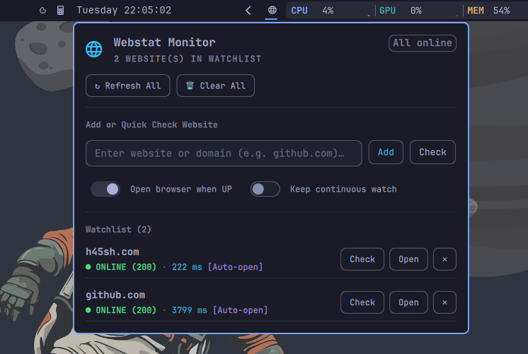

# omarchy-webstat

Omarchy shell top-bar widget and management panel for [webstat](https://github.com/h45sh/webstat).

Displays live website status, response latencies, and offline counts right in your Omarchy panel. Automatically notifies you when offline services recover and allows one-click browser launch.



## Features

- **Live Top-Bar Status Indicator**: Minimalist globe icon with dynamic badge counting offline sites.
- **Interactive Flyout Panel**: Instant visual status dashboard, latency metrics, and error diagnostics.
- **Add & Quick Check**: Test website status directly from the panel or queue it for background watching.
- **Zero-Latency Inotify Sync**: Reads state from `~/.local/state/webstat/sites.json` with zero process-polling overhead.
- **Instant Browser Launch**: Open recovered websites in your default browser with a single click.

## Prerequisites

This plugin interacts with the `webstat` Python CLI engine. Ensure `webstat` is installed on your system `$PATH`:

```bash
# Recommended: Install via pipx / PyPI
pipx install webstat
# or: pip install webstat

# Or via AUR (Arch Linux / Omarchy):
yay -S webstat-git

# Or install from source:
git clone https://github.com/h45sh/webstat.git
cd webstat
pip install .
```

Verify that `webstat` is reachable:
```bash
webstat --help
```

## Installation

Add and enable the plugin directly using the Omarchy CLI:

```bash
omarchy plugin add https://github.com/h45sh/omarchy-webstat.git --enable
```

To update the plugin in the future:
```bash
omarchy plugin update h45sh.webstat
```

## Development & Manual Installation

```bash
git clone https://github.com/h45sh/omarchy-webstat.git
cp -r omarchy-webstat ~/.config/omarchy/plugins/h45sh.webstat
omarchy plugin enable h45sh.webstat
```

To validate the plugin schema:
```bash
omarchy plugin validate .
```

## License

MIT © [h45sh](https://github.com/h45sh)
